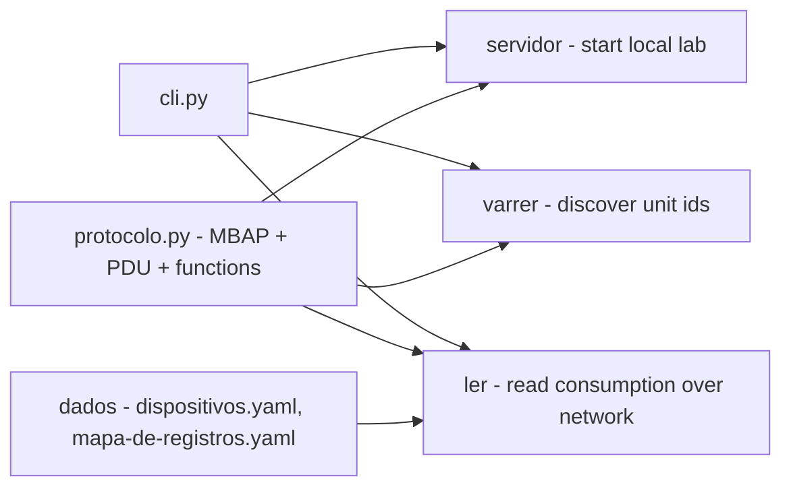

# modbus-scanner

**English** · [Português (Brasil)](README.md)

[](#) [](#) [](#) [](#.github/workflows/ci.yml) [](LICENSE)

## What it is

An implementation of the **Modbus TCP protocol from scratch**, in a lab: a **Modbus server** that runs locally, a **scanner** that sweeps the bus and discovers devices, and a **consumption read** (meters) over the network. The protocol — MBAP header, PDU, functions and exception codes — is built byte by byte. It is a networking/industrial-automation study project, fully local and fictitious.

## Status

An educational lab, working and tested (306 tests).

## Features

- **Modbus TCP lab server** for local development and testing.
- **Bus scanner** (`varrer`): discovers which unit ids respond.
- **Consumption read** (`ler`): reads meters over the network and writes the result to a file.
- **Register map** (`mapa`): documents the register layout per device.
- **Protocol from scratch**: MBAP header (7 bytes), PDU, functions 0x03 (read holding), 0x04 (read input), 0x06 (write single), 0x10 (write multiple) and exception codes.
- The data is fictitious and the protocol is built with no external library (stdlib only).

## Architecture

A `modbuslab` package with separate modules: `protocolo.py` (MBAP/PDU framing + functions + exceptions), `servidor.py` (lab server), `scanner.py` (sweep), `dispositivos.py` (catalog), `registros.py` (map) and `consumo.py` (meter read). Declarative configuration in `dados/*.yaml`.



## Stack

- Python ≥ 3.10
- PyYAML ≥ 6.0 (only runtime dependency)
- pytest + pytest-cov (dev)
- CI: GitHub Actions on `windows-latest` (Python 3.11), 70% coverage floor

## Repository layout

```
modbus-scanner/
├── src/modbuslab/
│   ├── protocolo.py      # MBAP/PDU framing, functions, exceptions
│   ├── servidor.py       # Modbus TCP lab server
│   ├── scanner.py        # sweeps the bus
│   ├── dispositivos.py · registros.py
│   ├── consumo.py        # meter read
│   └── cli.py            # servidor/varrer/ler/mapa commands
├── dados/
│   ├── dispositivos.yaml      # 3 meters
│   └── mapa-de-registros.yaml # register map per device
├── tests/             # 306 tests
├── docs/              # Modbus TCP protocol, register map
├── exemplos/          # generated consumption read
└── LICENSE            # MIT
```

## Prerequisites and installation

Python ≥ 3.10.

```bash
python -m pip install -e ".[dev]"
```

## How to run

```bash
# Start the Modbus TCP lab server
python -m modbuslab servidor --host 127.0.0.1 --porta 5020

# Sweep the bus and list who responds
python -m modbuslab varrer

# Read consumption over the network (writes the result)
python -m modbuslab ler --host 127.0.0.1 --porta 5020 --saida leitura.txt

# Show the register map
python -m modbuslab mapa
```

## Tests and quality

Real run (verified by the agent):

```bash
python -m pytest tests/
# 306 passed in 13.43s
```

- CI: `ci.yml` (windows-latest, Python 3.11) runs pytest with coverage (`fail-under=70`), checks encoding and the acceptance verification.

## Technical decisions and trade-offs

- **Protocol implemented from scratch** instead of a library (e.g. pymodbus): educational, no external dependency; the cost is re-implementing parts the library already does.
- **Real network read** (local socket), not from inside the object: consumption is read the way a client would, which actually validates the protocol.
- **YAML configuration**: adding a meter or register requires no code changes.

## Known limitations and roadmap

- Local simulation (127.0.0.1); it does not talk to real field devices.
- Implements basic reads (0x03/0x04) and writes (0x06/0x10); no broadcast or other functions.
- No security layer — documented in `docs/protocolo` (Modbus has no authentication).

## Development process

An individual project by Kelvin Oliveira, built with orchestrated AI agents and reviewed by the author. The protocol implementation, the register map and the review are the author's.

## License and author

MIT — Copyright (c) 2026 Kelvin Rebelo de Oliveira.

**Author**: [Kelvin Oliveira](https://github.com/KelvinOliveiraCode) · [Portfolio](https://kelvinoliveiracode.github.io/portfolio/)
