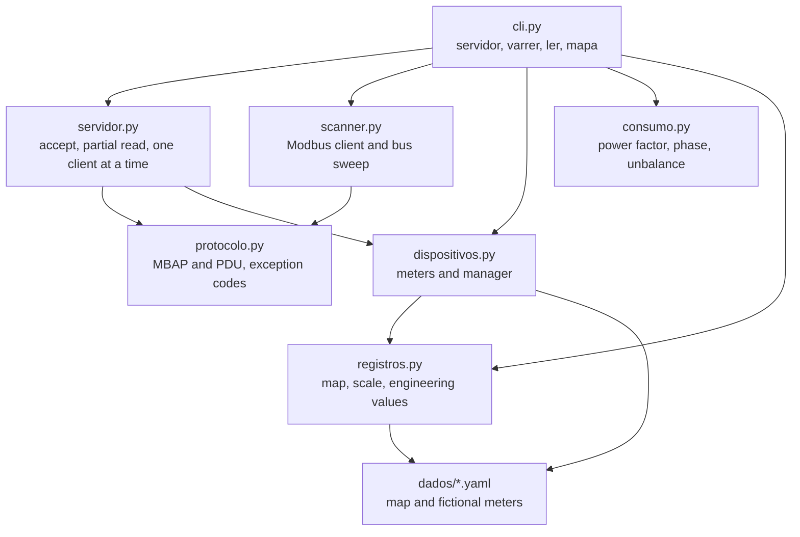

# modbuslab

<div align="center">

**English** · [Português (Brasil)](README.md)

</div>

[](https://github.com/KelvinOliveiraCode/modbus-scanner/actions/workflows/ci.yml)
[](https://www.python.org/)
[](https://pyyaml.org/)
[](docs/protocolo-modbus-tcp.md)
[](LICENSE)

### Modbus TCP from scratch: lab server, bus scanner and meter reading

**Learn the protocol by reading the wire, not the vendor manual.**

[Quick start](#quick-start) · [How it works](#how-it-works) · [What you can do](#what-you-can-do) · [Installation](#installation) · [Usage](#usage) · [Layout](#project-layout) · [Tests](#tests-and-checks) · [FAQ](#faq) · [Documentation](#documentation)

---

## What it is

Modbus TCP is easy to document and tedious to learn. The manual says function 3
reads registers, and a diagram shows the 7-byte header. What the manual does
not say is that the length field counts the PDU **plus the unit id**, so adding
7 instead of 6 hangs the read waiting for a byte that never comes.

`modbuslab` is a lab where that protocol is implemented from scratch, in
Python, over a standard-library socket. It ships:

- a **Modbus TCP server** serving fictional energy meters;
- a **bus scanner** that discovers who answers, without knowing the list
  beforehand;
- a **consumption read over the network**, with power factor, apparent power,
  accumulated energy and phase sequence.

Two decisions define the project.

**Consumption is read over the network, not from the object that produced
it.** The `ler` command builds consumption from registers read **over the
network**. It does not import the meter to do it. Consumption computed from
the process that generated the numbers proves nothing about the protocol, only
about the arithmetic.

**The protocol is documented, not the simulator.** The part every real Modbus
client carries alongside is the register map, because the protocol does not
say what a register means. The map is documentation, and it lives in
`docs/mapa-de-registros.md`.

## Quick start

Four commands and the lab is up. The detail of each one is in the sections
that follow.

```bash
git clone https://github.com/KelvinOliveiraCode/modbus-scanner.git
cd modbus-scanner
python -m venv .venv && .venv/bin/activate    # Windows: .venv\Scripts\Activate.ps1
pip install -e ".[dev]"
```

```bash
# Terminal 1: start the lab
modbuslab servidor

# Terminal 2: see who answers, and read consumption
modbuslab varrer --porta 5020 --de 1 --ate 3
modbuslab ler --porta 5020 --de 1 --ate 3
modbuslab mapa
```

The real output of each command is in
[`exemplos/leitura-consumo.txt`](exemplos/leitura-consumo.txt), generated by
the CLI and checked by CI.

## How it works

The protocol is the lowest layer, and it belongs to no side: the server and
the client use the same implementation, as in any real Modbus implementation.



The full diagram, with the layers and what each module guarantees, is in
[`docs/arquitetura.md`](docs/arquitetura.md).

The protocol guide, with the frame drawn in bytes, is in
[`docs/protocolo-modbus-tcp.md`](docs/protocolo-modbus-tcp.md).

## What you can do

| Command | What it does |
|---|---|
| `modbuslab servidor` | Starts the Modbus TCP server with the lab meters, on loopback. |
| `modbuslab varrer` | Sweeps a range of unit ids and lists who answered, without knowing the meter list. |
| `modbuslab ler` | Reads meter consumption **over the network** and computes the electrical figures, with alerts. |
| `modbuslab mapa` | Shows the register map: address, type, scale, unit and description. |

| Capability | Detail |
|---|---|
| Protocol from scratch | MBAP and PDU implemented over a standard-library socket, with no third-party library. |
| Dispatch by unit id | Two meters can have register 0 with different values and still be two meters. |
| Partial TCP read | `recv` returns what has arrived so far; the server buffers until it has MBAP plus PDU. |
| Several requests per connection | The client keeps the connection open; the server serves in a loop, not just once. |
| 32-bit registers | High and low words convert together. Reading only the high word would give half the value. |
| Consumption calculation | Power factor, apparent power, accumulated energy, unbalance and phase sequence. |
| Inverted phase detection | The lab's three-phase meter has L2 and L3 swapped on purpose, and the consumption flags it. |
| Bilingual output | CLI messages come out in Portuguese and English on the same line. |
| Fictional data | No value here comes from a real meter. |

## Requirements

| Item | Version | Note |
|---|---|---|
| Python | 3.10 or later | CI runs 3.10 and 3.11, on Linux and Windows. |
| PyYAML | 6.0 or later | The only runtime dependency, used solely to read the data files. |
| OS | Linux, macOS or Windows | The lab runs on loopback and uses no platform API. |

There is no runtime dependency beyond PyYAML. An automation client that has to
install a dependency tree to read a meter does not run in the field.

## Installation

```bash
git clone https://github.com/KelvinOliveiraCode/modbus-scanner.git
cd modbus-scanner

python -m venv .venv
```

Activate the virtual environment:

```bash
# Linux and macOS
source .venv/bin/activate

# Windows (PowerShell)
.venv\Scripts\Activate.ps1
```

Install the package with the development extras:

```bash
pip install -e ".[dev]"
```

`pyproject.toml` is the single source of truth for dependencies. The
`requirements.txt` delegates to it:

```bash
pip install -r requirements.txt
```

> The default lab port is **5020**, not 502. The Modbus port 502 is
> privileged on Unix and would require administrator rights for a lab that
> runs on loopback.

## Usage

### Start the lab

```bash
modbuslab servidor
```

```
Modbus TCP em 127.0.0.1:5020 com 3 medidor(es)
Funcao 3 (holding) e 4 (input) / functions 3 and 4
  unit id 1: medidor-1pn (medidor monofasico), 8 registradores
  unit id 2: medidor-3pn (medidor trifasico), 15 registradores
  unit id 3: medidor-demanda (medidor de demanda), 8 registradores
CTRL+C para encerrar / press CTRL+C to stop
```

### Sweep the bus

In another terminal, with the server up:

```bash
modbuslab varrer --porta 5020 --de 1 --ate 3
```

```
Varredura em 127.0.0.1:5020 / bus sweep
Unit ids sondados: 3

 Unit  Respondeu   Funcao   Registrador 0  Observacao
-----  ---------- -------  --------------  --------------------------
    1  sim              4            2194  valor bruto 2194
    2  sim              4            2197  valor bruto 2197
    3  sim              4            9600  valor bruto 9600

Devices encontrados: 3 de 3 sondados
```

The scanner does not know how many meters exist. It probes, and whoever
answers shows up.

### Read consumption

```bash
modbuslab ler --porta 5020 --de 1 --ate 3
```

```
# Leitura de consumo por Modbus TCP
# host / port: 127.0.0.1:5020
# mapa / map: dados/mapa-de-registros.yaml
# valores lidos pela rede / values read over the network

 ID  Dispositivo      Tipo                       V       A        W     var     FP       kWh  Fases
---------------------------------------------------------------------------------------------------
  1  medidor-1pn      medidor monofasico     219.4   12.35     2430     890  0.939   18432.0  1
  2  medidor-3pn      medidor trifasico      219.7   54.90    10980    3120  0.962   91240.0  3 (negativa)
  3  medidor-demanda  medidor de demanda     220.3   43.58     9600    4100  0.920  412880.0  1
```

Meter 2 has the inverted phase sequence, and the consumption flags it:

```
Dispositivo 2 (medidor-3pn):
  Alertas:
    - sequencia de fase invertida: ordem L1-L3-L2 em vez de L1-L2-L3
```

To write the read to a file, use `--saida`:

```bash
modbuslab ler --porta 5020 --de 1 --ate 3 --saida leitura.txt
```

### Show the register map

```bash
modbuslab mapa
```

```
=== medidor_1pn ===
 End  Nome                 Tipo    Pal  Escala  Unidade  Descricao
------------------------------------------------------------------
   0  tensao               uint16    1      10  V        Tensao fase-neutro
   1  corrente             uint16    1     100  A        Corrente na fase
   2  potencia_ativa       uint16    1       1  W        Potencia ativa instantanea
   3  potencia_reativa     int16     1       1  var      Potencia reativa instantanea
   4  energia              uint32    2       1  kWh      Energia ativa acumulada, dois enderecos
   6  frequencia           uint16    1     100  Hz       Frequencia da rede
   7  fator_potencia       uint16    1    1000           Fator de potencia medido
```

### Use it as a library

```python
from modbuslab import ClienteModbus, carregar_ambiente, ler_dispositivo

gerenciador, _mapas = carregar_ambiente(
    "dados/dispositivos.yaml", "dados/mapa-de-registros.yaml"
)

with ClienteModbus("127.0.0.1", 5020, 2.0) as cliente:
    dados = ler_dispositivo(cliente, 1, gerenciador.buscar(1).mapa)

print(dados["tensao"], dados["fator_potencia"])
```

## Project layout

```
.
├── dados/                      lab data
│   ├── dispositivos.yaml       the 3 meters and their engineering values
│   └── mapa-de-registros.yaml  the registers of each meter type
├── docs/
│   ├── arquitetura.md          layers, dependencies and where to change things
│   ├── architecture.mermaid    the diagram as code
│   ├── mapa-de-registros.md    the map, address by address
│   └── protocolo-modbus-tcp.md the frame in bytes, function by function
├── exemplos/
│   └── leitura-consumo.txt     real CLI output, generated and checked by CI
├── src/modbuslab/
│   ├── protocolo.py            MBAP and PDU: the wire format
│   ├── registros.py            register map, scale and conversion
│   ├── dispositivos.py         meters and the manager that holds them
│   ├── consumo.py              electrical calculation
│   ├── servidor.py             Modbus TCP server over a socket
│   ├── scanner.py              Modbus client and bus sweep
│   └── cli.py                  parsing and rendering
├── tests/                      one test class per module
├── tools/
│   ├── verificar_aceite.py     acceptance proof of the whole flow
│   ├── gerar_exemplos.py       regenerates exemplos/ from real output
│   └── verificar_encoding.py   catches corrupted characters
├── .github/workflows/          lint, types, tests and platform matrix
├── pyproject.toml              dependencies and tool configuration
└── CHANGELOG.md                change history
```

## Tests and checks

```bash
# Full suite, with coverage
python -m pytest --cov=modbuslab --cov-report=term-missing

# Lint, format and types
ruff check .
ruff format --check .
mypy

# Acceptance proof: starts the lab, sweeps, reads and checks
python tools/verificar_aceite.py
```

| Check | What it proves |
|---|---|
| `pytest` | 309 cases pass, with 93% coverage and a 70% floor in `pyproject.toml`. |
| `ruff check` | No lint error: style, imports, ambiguous names, common mistakes. |
| `ruff format --check` | The code is in the format the repository requires. |
| `mypy` | The types line up, in strict mode. |
| `verificar_aceite.py` | The whole flow still delivers: the 3 meters read over the network, the inverted phase sequence identified, and consumption matching the registers. |

The suite proves each function works. The acceptance proof proves what the
suite does not prove on its own. Both are needed.

## FAQ

<details>
<summary><strong>Do I need a real Modbus meter to use this?</strong></summary>

No. The lab plants 3 fictional meters from `dados/*.yaml`. All values are
invented, and their only purpose is to exercise the protocol.

</details>

<details>
<summary><strong>Can I use this in production?</strong></summary>

No. This is a study lab. It runs on loopback, has no authentication, has no
persistence and serves one client at a time. Modbus TCP itself is
structurally insecure: the protocol guide explains that in detail.

</details>

<details>
<summary><strong>Why port 5020 and not 502?</strong></summary>

502 is the default Modbus port, but on Unix it is privileged. A lab that runs
on loopback should not need `sudo` to start. 5020 avoids that and conflicts
with nothing.

</details>

<details>
<summary><strong>Does the server handle several clients at once?</strong></summary>

No. It serves one client at a time, and a second connection waits for the
first to finish. That does not show up in the lab, because the client closes
the connection and opens a new one for each sweep.

</details>

<details>
<summary><strong>Why does an unknown unit id get no exception?</strong></summary>

Because exception 2 answers an invalid register address **on a unit that
exists**. An unknown unit id does not exist, and answering it would be
inventing a device. That silence is what makes the sweep cost time: the
client has to wait out the timeout of every id that is not there.

</details>

<details>
<summary><strong>Can I use my own meters?</strong></summary>

Yes. The maps and meters are YAML. Copy `dados/dispositivos.yaml` and
`dados/mapa-de-registros.yaml`, adjust the values, and point at them with
`--mapa` and `--dispositivos`. Every value is validated against the register
type at load time, so an out-of-range value fails there, not on the server's
first request.

</details>

<details>
<summary><strong>How is the sample output guaranteed?</strong></summary>

`tools/gerar_exemplos.py` starts the lab on a free port, runs the CLI for
real and writes the output. CI regenerates the file and fails if the
committed version diverges. If you change the CLI output on purpose,
regenerate it and commit it.

</details>

## Documentation

- [Architecture](docs/arquitetura.md) — layers, dependencies and where to change things.
- [Modbus TCP protocol](docs/protocolo-modbus-tcp.md) — the frame in bytes, function by function, and why the protocol has no security.
- [Register map](docs/mapa-de-registros.md) — address, type, scale and description of every register.
- [Changelog](CHANGELOG.md) — what changed in each version.
- [Contributing](CONTRIBUTING.md) — environment, checks and commit conventions.
- [Security](SECURITY.md) — the security boundary of the lab.

## Contributing

Read the [contribution guide](CONTRIBUTING.md). In short: one problem per
issue, small commits in Conventional Commits, and the suite, the lint, the
types and the acceptance proof passing before the pull request.

## Security

Vulnerabilities go through the repository's **Security** tab, never a public
issue. The security boundary of the lab is described in
[SECURITY.md](SECURITY.md).

## License

[MIT](LICENSE) © Kelvin Oliveira

## Author

**Kelvin Oliveira** · [GitHub](https://github.com/KelvinOliveiraCode) ·
[Portfolio](https://kelvinoliveiracode.github.io/portfolio/)
