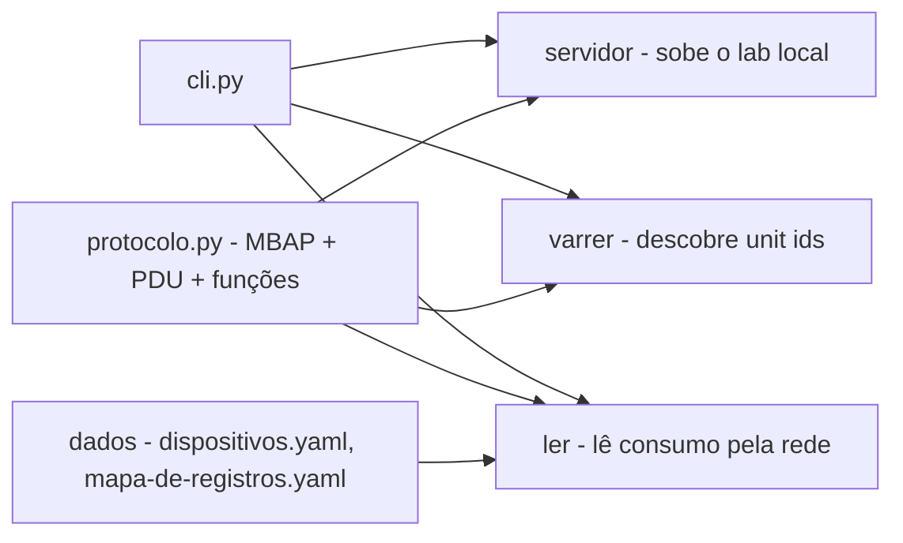

# modbus-scanner

[English](README.en.md) · **Português (Brasil)**

[](#) [](#) [](#) [](#.github/workflows/ci.yml) [](LICENSE)

## O que é

Implementação do **protocolo Modbus TCP do zero**, em laboratório: um **servidor Modbus** que sobe localmente, um **scanner** que varre o barramento e descobre dispositivos, e uma **leitura de consumo** (medidores) pela rede. O protocolo — cabeçalho MBAP, PDU, funções e códigos de exceção — é montado byte a byte. É um projeto de estudo de redes/automação industrial, 100% local e fictício.

## Status

Laboratório educacional, funcional e testado (306 testes).

## Funcionalidades

- **Servidor Modbus TCP** de laboratório para desenvolvimento e testes locais.
- **Scanner de barramento** (`varrer`): descobre quais unit ids respondem.
- **Leitura de consumo** (`ler`): lê medidores pela rede e grava o resultado em arquivo.
- **Mapa de registradores** (`mapa`): documenta a disposição dos registradores por dispositivo.
- **Protocolo do zero**: cabeçalho MBAP (7 bytes), PDU, funções 0x03 (read holding), 0x04 (read input), 0x06 (write single), 0x10 (write multiple) e códigos de exceção.
- Os dados são fictícios e o protocolo é montado sem biblioteca externa (só stdlib).

## Arquitetura

Pacote `modbuslab` com módulos separados: `protocolo.py` (framing MBAP/PDU + funções + exceções), `servidor.py` (servidor de lab), `scanner.py` (varredura), `dispositivos.py` (catálogo), `registros.py` (mapa) e `consumo.py` (leitura de medidores). Configuração declarativa em `dados/*.yaml`.



## Stack

- Python ≥ 3.10
- PyYAML ≥ 6.0 (única dependência de runtime)
- pytest + pytest-cov (dev)
- CI: GitHub Actions em `windows-latest` (Python 3.11), cobertura mínima 70%

## Estrutura do repositório

```
modbus-scanner/
├── src/modbuslab/
│   ├── protocolo.py      # frameboxing MBAP/PDU, funções, exceções
│   ├── servidor.py       # servidor Modbus TCP de lab
│   ├── scanner.py        # varre o barramento
│   ├── dispositivos.py · registros.py
│   ├── consumo.py        # leitura de medidores
│   └── cli.py            # comandos servidor/varrer/ler/mapa
├── dados/
│   ├── dispositivos.yaml      # 3 medidores
│   └── mapa-de-registros.yaml # mapa por dispositivo
├── tests/             # 306 testes
├── docs/              # protocolo Modbus TCP, mapa de registradores
├── exemplos/          # leitura de consumo gerada
└── LICENSE            # MIT
```

## Pré-requisitos e instalação

Python ≥ 3.10.

```bash
python -m pip install -e ".[dev]"
```

## Como executar

```bash
# Sobe o servidor Modbus TCP de laboratório
python -m modbuslab servidor --host 127.0.0.1 --porta 5020

# Varre o barramento e lista quem responde
python -m modbuslab varrer

# Lê o consumo pela rede (grava o resultado)
python -m modbuslab ler --host 127.0.0.1 --porta 5020 --saida leitura.txt

# Mostra o mapa de registradores
python -m modbuslab mapa
```

## Testes e qualidade

Execução real (verificada pelo agente):

```bash
python -m pytest tests/
# 306 passed in 13.43s
```

- CI: `ci.yml` (windows-latest, Python 3.11) roda pytest com cobertura (`fail-under=70`), checa encoding e a verificação de aceite.

## Decisões técnicas e trade-offs

- **Protocolo implementado do zero** em vez de uma lib (ex.: pymodbus): educativo, sem dependência externa; o custo é reimplementar partes que a lib já faz.
- **Leitura pela rede real** (socket local), não de dentro do objeto: o consumo é lido como o cliente leria, o que valida o protocolo de verdade.
- **Configuração via YAML**: adicionar um medidor ou registrador não exige tocar no código.

## Limitações conhecidas e roadmap

- Simulação local (127.0.0.1); não se comunica com equipamentos reais de campo.
- Implementa leitura (0x03/0x04) e escrita (0x06/0x10) básicas; sem broadcast/outras funções.
- Sem camada de segurança — documentado no `docs/protocolo` (Modbus não tem autenticação).

## Processo de desenvolvimento

Projeto individual de Kelvin Oliveira, construído com agentes de IA orquestrados e revisado pelo autor. A implementação do protocolo, o mapa de registradores e a revisão são do autor.

## Licença e autor

MIT — Copyright (c) 2026 Kelvin Rebelo de Oliveira.

**Autor**: [Kelvin Oliveira](https://github.com/KelvinOliveiraCode) · [Portfólio](https://kelvinoliveiracode.github.io/portfolio/)
