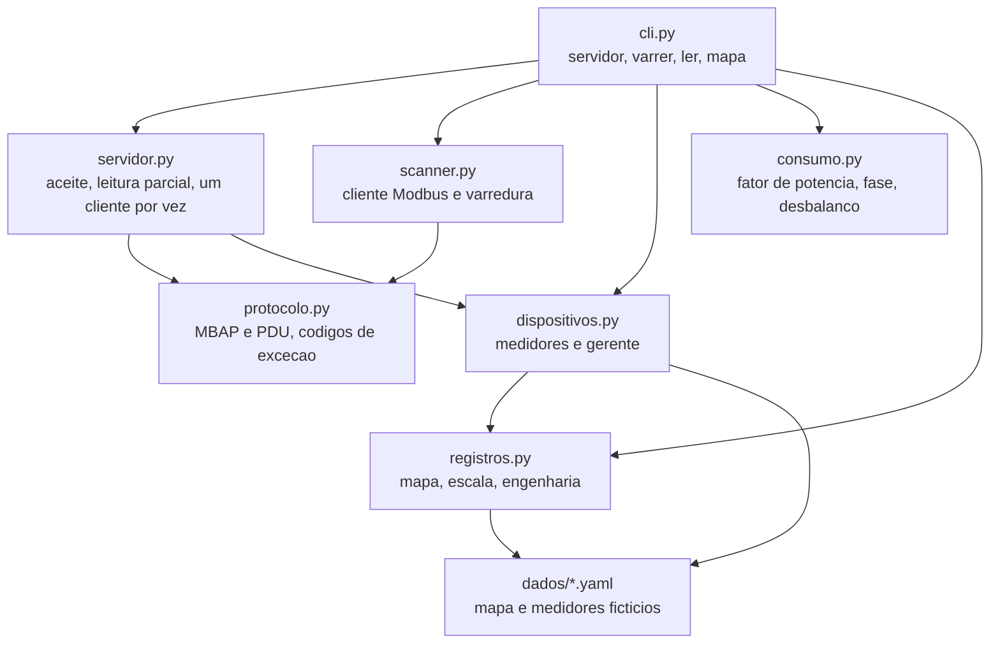

# modbuslab

<div align="center">

[English](README.en.md) · **Português (Brasil)**

</div>

[](https://github.com/KelvinOliveiraCode/modbus-scanner/actions/workflows/ci.yml)
[](https://www.python.org/)
[](https://pyyaml.org/)
[](docs/protocolo-modbus-tcp.md)
[](LICENSE)

### Protocolo Modbus TCP do zero: servidor de laboratório, scanner de barramento e leitura de medidores

**Aprenda o protocolo lendo o fio, não a documentação do fabricante.**

[Início rápido](#início-rápido) · [Como funciona](#como-funciona) · [O que dá para fazer](#o-que-dá-para-fazer) · [Instalação](#instalação) · [Uso](#uso) · [Estrutura](#estrutura-do-projeto) · [Testes](#testes-e-verificações) · [Perguntas frequentes](#perguntas-frequentes) · [Documentação](#documentação)

---

## O que é

O Modbus TCP é simples de documentar e chato de aprender. O manual diz que a
função 3 lê registradores, e um diagrama mostra o cabeçalho de 7 bytes. O que
o manual não diz é que o campo de comprimento conta o PDU **mais o unit id**,
e somar 7 em vez de 6 trava a leitura esperando um byte que nunca vem.

O `modbuslab` é um laboratório onde esse protocolo está implementado do zero,
em Python, sobre socket da biblioteca padrão. Ele traz:

- um **servidor Modbus TCP** que serve medidores de energia fictícios;
- um **scanner de barramento** que descobre quem responde, sem conhecer a
  lista de medidores de antemão;
- uma **leitura de consumo pela rede**, com cálculo de fator de potência,
  potência aparente, energia acumulada e sequência de fase.

Duas decisões definem o projeto.

**O consumo é lido pela rede, não do objeto que o originou.** O comando `ler`
monta o consumo a partir de registradores lidos **pela rede**. Ele não importa
o medidor para isso. Um consumo calculado a partir do processo que gerou os
números não demonstra nada sobre o protocolo, só sobre a aritmética.

**O protocolo está documentado, não o simulador.** A parte que todo cliente
Modbus real carrega junto é o mapa de registradores, porque o protocolo não
diz o que um registrador significa. O mapa é documentação, e está em
`docs/mapa-de-registros.md`.

## Início rápido

Quatro comandos e o laboratório está no ar. O detalhe de cada um está nas
seções seguintes.

```bash
git clone https://github.com/KelvinOliveiraCode/modbus-scanner.git
cd modbus-scanner
python -m venv .venv && .venv/bin/activate    # Windows: .venv\Scripts\Activate.ps1
pip install -e ".[dev]"
```

```bash
# Terminal 1: sobe o laboratorio
modbuslab servidor

# Terminal 2: ve o que responde e le o consumo
modbuslab varrer --porta 5020 --de 1 --ate 3
modbuslab ler --porta 5020 --de 1 --ate 3
modbuslab mapa
```

A saída real de cada comando está em
[`exemplos/leitura-consumo.txt`](exemplos/leitura-consumo.txt), gerada pela
CLI e conferida pelo CI.

## Como funciona

O protocolo é a camada mais baixa, e não pertence a nenhum lado: o servidor e
o cliente usam a mesma implementação, como acontece em qualquer implementação
real.



O diagrama completo, com as camadas e o que cada módulo garante, está em
[`docs/arquitetura.md`](docs/arquitetura.md).

O guia do protocolo, com o desenho do quadro em bytes, está em
[`docs/protocolo-modbus-tcp.md`](docs/protocolo-modbus-tcp.md).

## O que dá para fazer

| Comando | O que faz |
|---|---|
| `modbuslab servidor` | Sobe o servidor Modbus TCP com os medidores do laboratório, em loopback. |
| `modbuslab varrer` | Varre um intervalo de unit ids e lista quem respondeu, sem conhecer a lista de medidores. |
| `modbuslab ler` | Lê o consumo dos medidores **pela rede** e calcula o consumo elétrico, com alertas. |
| `modbuslab mapa` | Mostra o mapa de registradores: endereço, tipo, escala, unidade e descrição. |

| Recurso | Detalhe |
|---|---|
| Protocolo do zero | MBAP e PDU implementados sobre socket da biblioteca padrão, sem biblioteca de terceiro. |
| Despacho por unit id | Dois medidores podem ter o registrador 0 com valores diferentes e continuam sendo dois medidores. |
| Leitura parcial de TCP | `recv` devolve o que chegou até agora; o servidor acumula em buffer até ter MBAP mais PDU. |
| Várias requisições por conexão | O cliente mantém a conexão aberta; o servidor atende em ciclo, não fecha após a primeira resposta. |
| Registradores de 32 bits | Palavras alta e baixa entram juntas na conversão. Ler só a palavra alta daria metade do valor. |
| Cálculo de consumo | Fator de potência, potência aparente, energia acumulada, desbalanco e sequência de fase. |
| Detecção de sequência invertida | O medidor trifásico do laboratório está com L2 e L3 trocadas de propósito, e o consumo acusa. |
| Saída bilingue | As mensagens da CLI saem em português e em inglês, na mesma linha. |
| Dados fictícios | Nenhum valor aqui é de um medidor real. |

## Requisitos

| Item | Versão | Observação |
|---|---|---|
| Python | 3.10 ou superior | O CI roda em 3.10 e 3.11, em Linux e Windows. |
| PyYAML | 6.0 ou superior | Única dependência de runtime, usada só para ler os arquivos de dados. |
| Sistema | Linux, macOS ou Windows | O laboratório roda em loopback e não usa API de sistema. |

Não há dependência de runtime além do PyYAML. Um cliente de automação que
precisa instalar uma árvore de dependências para ler um medidor não roda em
campo.

## Instalação

```bash
git clone https://github.com/KelvinOliveiraCode/modbus-scanner.git
cd modbus-scanner

python -m venv .venv
```

Ative o ambiente virtual:

```bash
# Linux e macOS
source .venv/bin/activate

# Windows (PowerShell)
.venv\Scripts\Activate.ps1
```

Instale o pacote com os extras de desenvolvimento:

```bash
pip install -e ".[dev]"
```

O `pyproject.toml` é a fonte única de verdade das dependências. O
`requirements.txt` delega para ele:

```bash
pip install -r requirements.txt
```

> A porta padrão do laboratório é a **5020**, e não a 502. A porta 502 do
> Modbus é privilegiada no Unix e exigiria privilégio de administrador para
> um laboratório que roda em loopback.

## Uso

### Subir o laboratório

```bash
modbuslab servidor
```

```
Modbus TCP em 127.0.0.1:5020 com 3 medidor(es)
Funcao 3 (holding) e 4 (input) / functions 3 and 4
  unit id 1: medidor-1pn (medidor monofasico), 8 registradores
  unit id 2: medidor-3pn (medidor trifasico), 15 registradores
  unit id 3: medidor-demanda (medidor de demanda), 8 registradores
CTRL+C para encerrar / press CTRL+C to stop
```

### Varrer o barramento

Em outro terminal, com o servidor no ar:

```bash
modbuslab varrer --porta 5020 --de 1 --ate 3
```

```
Varredura em 127.0.0.1:5020 / bus sweep
Unit ids sondados: 3

 Unit  Respondeu   Funcao   Registrador 0  Observacao
-----  ---------- -------  --------------  --------------------------
    1  sim              4            2194  valor bruto 2194
    2  sim              4            2197  valor bruto 2197
    3  sim              4            9600  valor bruto 9600

Devices encontrados: 3 de 3 sondados
```

O scanner não sabe quantos medidores existem. Ele sonda e quem responde,
aparece.

### Ler o consumo

```bash
modbuslab ler --porta 5020 --de 1 --ate 3
```

```
# Leitura de consumo por Modbus TCP
# host / port: 127.0.0.1:5020
# mapa / map: dados/mapa-de-registros.yaml
# valores lidos pela rede / values read over the network

 ID  Dispositivo      Tipo                       V       A        W     var     FP       kWh  Fases
---------------------------------------------------------------------------------------------------
  1  medidor-1pn      medidor monofasico     219.4   12.35     2430     890  0.939   18432.0  1
  2  medidor-3pn      medidor trifasico      219.7   54.90    10980    3120  0.962   91240.0  3 (negativa)
  3  medidor-demanda  medidor de demanda     220.3   43.58     9600    4100  0.920  412880.0  1
```

O medidor 2 vem com a sequência de fase invertida, e o consumo acusa:

```
Dispositivo 2 (medidor-3pn):
  Alertas:
    - sequencia de fase invertida: ordem L1-L3-L2 em vez de L1-L2-L3
```

Para gravar a leitura em arquivo, use `--saida`:

```bash
modbuslab ler --porta 5020 --de 1 --ate 3 --saida leitura.txt
```

### Ver o mapa de registradores

```bash
modbuslab mapa
```

```
=== medidor_1pn ===
 End  Nome                 Tipo    Pal  Escala  Unidade  Descricao
------------------------------------------------------------------
   0  tensao               uint16    1      10  V        Tensao fase-neutro
   1  corrente             uint16    1     100  A        Corrente na fase
   2  potencia_ativa       uint16    1       1  W        Potencia ativa instantanea
   3  potencia_reativa     int16     1       1  var      Potencia reativa instantanea
   4  energia              uint32    2       1  kWh      Energia ativa acumulada, dois enderecos
   6  frequencia           uint16    1     100  Hz       Frequencia da rede
   7  fator_potencia       uint16    1    1000           Fator de potencia medido
```

### Usar como biblioteca

```python
from modbuslab import ClienteModbus, carregar_ambiente, ler_dispositivo

gerenciador, _mapas = carregar_ambiente(
    "dados/dispositivos.yaml", "dados/mapa-de-registros.yaml"
)

with ClienteModbus("127.0.0.1", 5020, 2.0) as cliente:
    dados = ler_dispositivo(cliente, 1, gerenciador.buscar(1).mapa)

print(dados["tensao"], dados["fator_potencia"])
```

## Estrutura do projeto

```
.
├── dados/                      dados do laboratório
│   ├── dispositivos.yaml       os 3 medidores e seus valores de engenharia
│   └── mapa-de-registros.yaml  os registradores de cada tipo de medidor
├── docs/
│   ├── arquitetura.md          camadas, dependências e onde mexer
│   ├── architecture.mermaid    diagrama em código
│   ├── mapa-de-registros.md    o mapa, endereço por endereço
│   └── protocolo-modbus-tcp.md o quadro em bytes, função por função
├── exemplos/
│   └── leitura-consumo.txt     saída real da CLI, gerada e conferida pelo CI
├── src/modbuslab/
│   ├── protocolo.py            MBAP e PDU: o formato do fio
│   ├── registros.py            mapa de registradores, escala e conversão
│   ├── dispositivos.py         medidores e o gerente que os reúne
│   ├── consumo.py              cálculo elétrico
│   ├── servidor.py             servidor Modbus TCP sobre socket
│   ├── scanner.py              cliente Modbus e varredura de barramento
│   └── cli.py                  parsing e renderização
├── tests/                      uma classe de teste por módulo
├── tools/
│   ├── verificar_aceite.py     prova de aceite do fluxo inteiro
│   ├── gerar_exemplos.py       regenera exemplos/ a partir da saída real
│   └── verificar_encoding.py   barra caractere corrompido
├── .github/workflows/          lint, tipos, testes e matriz de plataformas
├── pyproject.toml              dependências e configuração das ferramentas
└── CHANGELOG.md                histórico de mudanças
```

## Testes e verificações

```bash
# Suíte completa, com cobertura
python -m pytest --cov=modbuslab --cov-report=term-missing

# Lint, formato e tipos
ruff check .
ruff format --check .
mypy

# Prova de aceite: sobe o lab, varre, lê e confere
python tools/verificar_aceite.py
```

| Verificação | O que prova |
|---|---|
| `pytest` | 309 casos passam, com 93% de cobertura e piso de 70% no `pyproject.toml`. |
| `ruff check` | Sem erro de lint: estilo, imports, nomes ambíguos, erros comuns. |
| `ruff format --check` | O código está no formato que o repositório exige. |
| `mypy` | Os tipos batem, em modo estrito. |
| `verificar_aceite.py` | O fluxo inteiro ainda entrega: os 3 medidores lidos pela rede, a sequência de fase invertida identificada e o consumo batendo com os registradores. |

A suíte prova que cada função funciona. A prova de aceite prova o que a
suíte não prova sozinha. As duas são necessárias.

## Perguntas frequentes

<details>
<summary><strong>Preciso de um medidor Modbus real para usar isso?</strong></summary>

Não. O laboratório planta 3 medidores fictícios a partir de `dados/*.yaml`.
Todos os valores são inventados, e o único propósito deles é exercitar o
protocolo.

</details>

<details>
<summary><strong>Posso usar em produção?</strong></summary>

Não. Este é um laboratório de estudo. Ele roda em loopback, não tem
autenticação, não tem persistência e atende um cliente por vez. O Modbus TCP
em si é estruturalmente sem segurança: o guia do protocolo explica isso em
detalhe.

</details>

<details>
<summary><strong>Por que a porta 5020 e não a 502?</strong></summary>

A 502 é a porta padrão do Modbus, mas no Unix ela é privilegiada. Um
laboratório que roda em loopback não deveria exigir `sudo` para subir. A 5020
evita isso e não conflita com nada.

</details>

<details>
<summary><strong>O servidor atende vários clientes ao mesmo tempo?</strong></summary>

Não. Ele atende um cliente por vez, e a segunda conexão espera a primeira
terminar. No laboratório isso não aparece, porque o cliente fecha a conexão e
abre outra para cada varredura.

</details>

<details>
<summary><strong>Por que o unit id desconhecido não recebe exceção?</strong></summary>

Porque a exceção 2 responde a endereço de registrador inválido **em um unit
que existe**. Um unit id desconhecido não existe, e responder a ele seria
inventar um dispositivo. Esse silêncio é o que faz a varredura custar tempo:
o cliente precisa esperar o timeout de cada id que não está lá.

</details>

<details>
<summary><strong>Posso usar meus próprios medidores?</strong></summary>

Sim. Os mapas e os medidores são YAML. Copie `dados/dispositivos.yaml` e
`dados/mapa-de-registros.yaml`, ajuste os valores e aponte para eles com
`--mapa` e `--dispositivos`. Cada valor é validado contra o tipo do
registrador no carregamento, então um valor fora de faixa falha ali, e não no
primeiro atendimento do servidor.

</details>

<details>
<summary><strong>Como os exemplos de saída são garantidos?</strong></summary>

`tools/gerar_exemplos.py` sobe o lab numa porta livre, roda a CLI de verdade e
grava a saída. O CI regenera o arquivo e falha se o que está commitado
divergir. Se você mudar a saída da CLI de propósito, regenere e commite.

</details>

## Documentação

- [Arquitetura](docs/arquitetura.md) — camadas, dependências e onde mexer.
- [Protocolo Modbus TCP](docs/protocolo-modbus-tcp.md) — o quadro em bytes, função por função, e por que o protocolo não tem segurança.
- [Mapa de registradores](docs/mapa-de-registros.md) — endereço, tipo, escala e descrição de cada registrador.
- [Changelog](CHANGELOG.md) — o que mudou em cada versão.
- [Contribuindo](CONTRIBUTING.md) — ambiente, verificações e padrão de commits.
- [Segurança](SECURITY.md) — a fronteira de segurança do laboratório.

## Contribuindo

Leia o [guia de contribuição](CONTRIBUTING.md). O resumo: um problema por
issue, commits pequenos em Conventional Commits, e a suíte, o lint, os tipos e
a prova de aceite passando antes do pull request.

## Segurança

Vulnerabilidades vão pela aba **Security** do repositório, nunca por issue
pública. A fronteira de segurança do laboratório está descrita em
[SECURITY.md](SECURITY.md).

## Licença

[MIT](LICENSE) © Kelvin Oliveira

## Autor

**Kelvin Oliveira** · [GitHub](https://github.com/KelvinOliveiraCode) ·
[Portfólio](https://kelvinoliveiracode.github.io/portfolio/)
